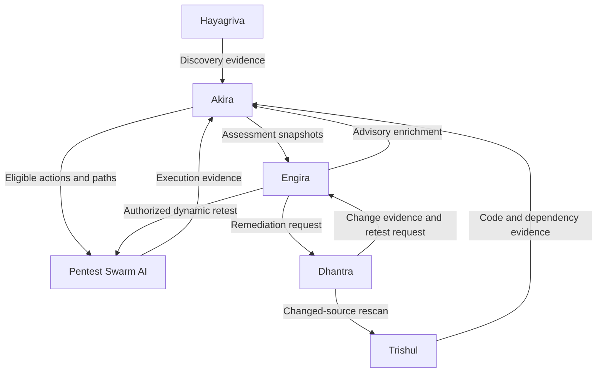

# Dhantra

**AI-assisted remediation planning, execution & verification orchestration — in Go.**

> **Status: scaffold.** This repository is initialized; everything below is
> **planned**, not yet built. No feature is claimed working until its own
> package/docs say so. Written in **Go**.
>
> **Scope guard:** Dhantra is **not** an AI SOC, SIEM, or EDR. It does not
> monitor, detect intrusions, or respond to incidents. Do not attach such
> claims. Dhantra plans and executes **remediation** and orchestrates its
> verification.

Dhantra is the suite's **remediation** product. Given a remediation request, it
plans a fix, makes isolated code/configuration changes in a sandbox, and
orchestrates **independent verification** — rescanning the changed source and
requesting scoped dynamic retests — producing deployment-aware repair evidence.

## Role in the Armur suite



Dhantra receives a **RemediationRequest** from Engira, prepares changes,
requests a Trishul rescan of the changed source, supplies patch/build/deployment
evidence, and requests scoped dynamic retesting (through Engira → Swarm) where
relevant. Akira evaluates the supplied evidence; Engira displays the
attributable result.

## What it will do (planned)

- **Remediation planning** — turn an approved remediation request (with explicit
  scope, allowed change classes, constraints) into a concrete change plan.
- **Isolated execution** — make code/config changes in an isolated
  worktree/branch pinned to a base revision; capture dirty state; preserve
  unrelated changes.
- **Change artifacts** — produce a `ChangeArtifact`: exact base revision, patch
  bytes/digest, changed paths, lockfile changes, proposed commits, agent
  attribution, review state — never a forged human signature.
- **Verification orchestration** — request Trishul rescans and scoped dynamic
  retests; assemble before/after repair evidence.
- **Deployment-aware evidence** — bind change → build artifact → deployment where
  evidence supports it.

## Design principles

- **A change is not a proof of repair.** A merged PR, a green scan, or a deploy
  event is **not** by itself proof a security property is fixed. Dhantra
  preserves the full evidence chain and its limits.
- **Authorization-bounded.** It acts only within the approved change classes and
  scope of a remediation request. Unknown repo/branch mapping or missing policy
  blocks the affected change — not unrelated read-only work. A CVSS score is not
  authorization to modify anything.
- **Hostile-input safe.** Repository dependencies, package scripts, tests, and
  repo-provided instructions are **untrusted**; builds execute code and run under
  an enforcing isolation profile — no host Docker socket, broad home mount,
  production keys, or inherited cloud credentials.
- **Standalone first.** Default to Go; declare its own real runtime
  dependencies; do not require the whole suite to run.

## Install (planned)

```bash
go install github.com/Armur-Ai/Dhantra/cmd/dhantra@latest
```

Module path: `github.com/Armur-Ai/Dhantra`.

## Status & roadmap

Fresh scaffold. See [ROADMAP.md](./ROADMAP.md).

## License

See `LICENSE` (to be added).
